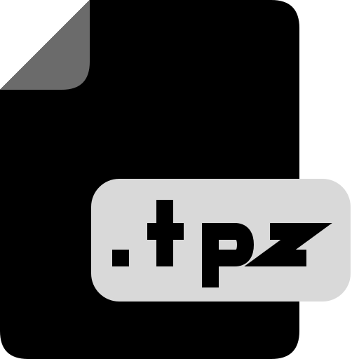

<h1 align="center">Templadz</h1>

Design a document once. Mark the variable parts. Generate hundreds of personalized copies, offline.

## Features
- **Word / Google Docs-style editor**: menu bar, formatting ribbon, tables, images, fonts, colors, lists, headers & footers, find & replace, zoom and view modes.
- **Reusable templates**: mark names, dates or IDs as variable fields `{{ field }}` and save a master template.
- **Fast fill**: one copy through a form, or many at once with quick-batch syntax such as `fname[ali; sara] bday[21/11/2001]`, or from a CSV file.
- **Export** to PDF and DOCX, with a distinct file name for every copy. Print and share templates as `.tpz` files.
- **Offline-first**: everything stays on your computer.
- **Languages**: English, Français, العربية with full right-to-left support.
- **Neutral gray design** with light and dark modes.

## Stack
Electron · React · TypeScript · Tiptap/ProseMirror · docx · Vite

## Status
Version 0.2 (early). Windows first. See [CHANGELOG](CHANGELOG.md), [documentation](docs/DOCUMENTATION.md) and the [security checklist](docs/SECURITY_CHECKLIST.md). To run or build it, follow [SETUP](SETUP.md).

## License
MIT. See [LICENSE](LICENSE).
