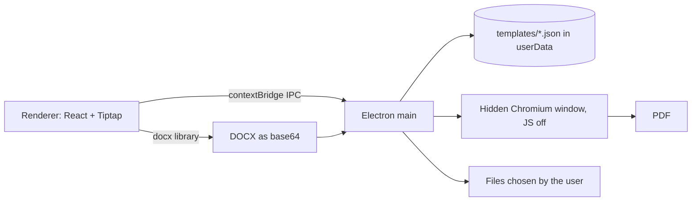

# Templadz documentation (v0.2)

## 1. Architecture

- **Renderer** (`src/`): UI, editor, fill logic, DOCX generation. No Node access (`contextIsolation`, `sandbox`, `nodeIntegration:false`).
- **Main** (`electron/main.cjs`): file storage, dialogs, PDF rendering, activation.
- **Preload** exposes a fixed list of functions (`window.templadz`), nothing generic.
- Networking: none. The app makes no network requests.

## 2. Data model
Template file `userData/templates/<uuid>.json`:
```json
{ "name": "Certificate", "header": "", "footer": "Page {{page}} of {{pages}}", "doc": { "type": "doc", "content": [] } }
```
`doc` is ProseMirror JSON. A variable is an inline node `{ "type": "field", "attrs": { "key": "fname" } }`. Other custom nodes: `pageBreak`. Custom attributes: `dir` (auto|ltr|rtl), `lineHeight`, `fontSize` (on `textStyle`).
`.tpz` = the same JSON plus `"format": "templadz", "v": 2`.
Header/footer tokens: `{{page}}`, `{{pages}}`, `{{date}}`.

## 3. Quick-batch syntax
`key[v1; v2; v3] key2[...] ...`
- Separators: `;` if the brackets contain a semicolon, otherwise `,`. (Use `;` when a value contains a comma.)
- One value broadcasts to all rows: `bday[21/11/2001]`.
- Several values must all have the same length, otherwise an error is shown and nothing is exported.
- Fields not mentioned use the value typed in the single-copy form.
- Unknown keys and text outside brackets are errors.
- CSV alternative: header row = field keys (`;` or `,`), one row per copy.
- Output names: `TemplateName_<first field value>_<second field value>.pdf|docx`; duplicates get `_<row number>`.

Example: `fname[meriem; rayan; jolie; casandra] lname[malak; kidra; kilnma; kolp] bday[21/11/2001]` produces 4 copies with the same date.

## 4. Shortcut map
| Action | Shortcut |
|---|---|
| New / Open / Save | Ctrl+N / Ctrl+O / Ctrl+S |
| Export PDF / DOCX | Ctrl+Shift+P / Ctrl+Shift+D |
| Print | Ctrl+P |
| Undo / Redo | Ctrl+Z / Ctrl+Y |
| Find / Replace | Ctrl+F / Ctrl+H |
| Select all | Ctrl+A |
| Variable field | Ctrl+Shift+V |
| Page break | Ctrl+Enter |
| Bold / Italic / Underline | Ctrl+B / Ctrl+I / Ctrl+U |
| Strikethrough | Alt+Shift+5 |
| Align left / center / right / justify | Ctrl+Shift+L / E / R / J |
| Bullets / Numbered | Ctrl+Shift+8 / Ctrl+Shift+7 |
| Clear formatting | Ctrl+\ |
| Quick-fill form | Ctrl+Shift+F |
| Word count | Ctrl+Shift+C |
| Focus mode | F11 |

## 5. Known limits
- Page count and "Page X of Y" are estimates; the editor shows one continuous sheet with page guides. PDF output paginates correctly.
- DOCX is a faithful-as-possible conversion, not identical to the PDF. Fonts must be installed on the opening computer.
- Find matches inside a single formatting run only.
- Tables always lay out left-to-right.
- No image resizing, no version history, no undo across save.
- Activation is a placeholder (see SETUP).
