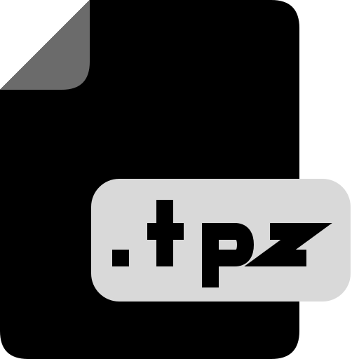
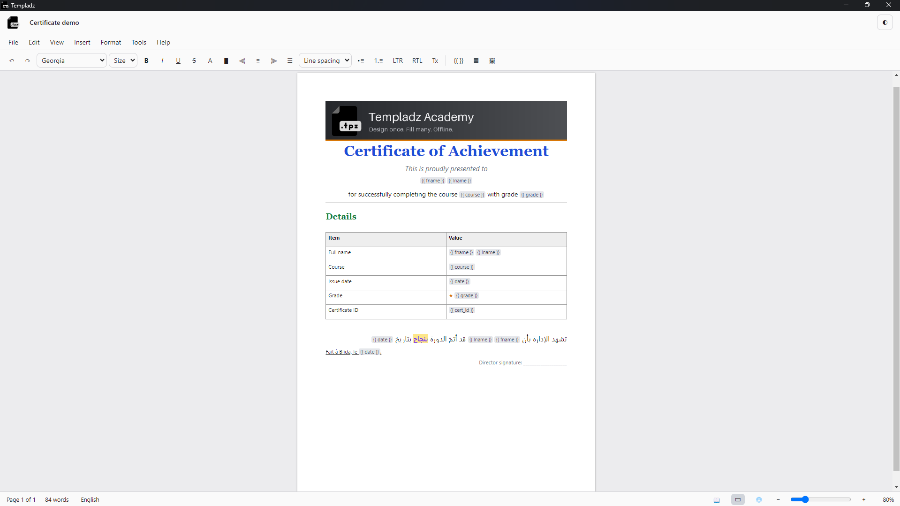
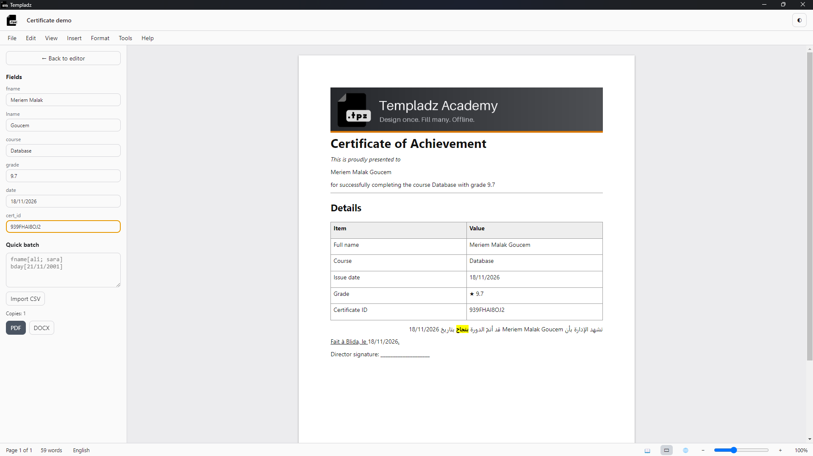
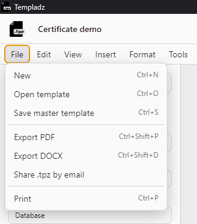
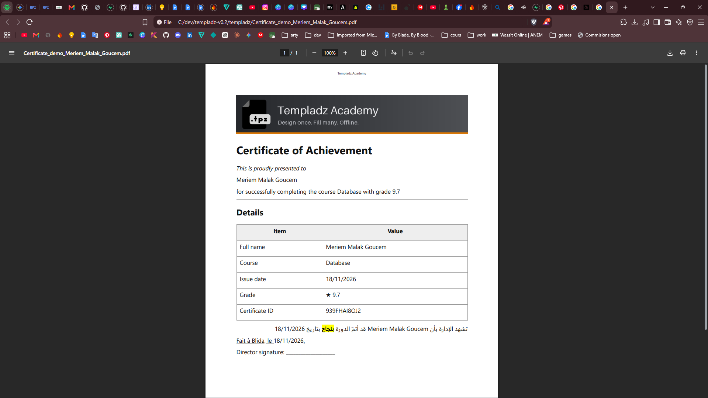

<p align="center">
  
</p>

<h1 align="center">Templadz</h1>

<p align="center">
  Design a document once. Mark the variable parts.<br>
  Generate hundreds of personalized copies, offline.
</p>

<p align="center">
  
  
  
  
</p>

---

## Screenshots

<!--
  Add your screenshots to docs/screenshots/ with these names
  (or change the filenames below).
-->

<table>
  <tr>
    <td align="center"><br><sub>Design master template with <code>{{ field }}</code> placeholders</sub></td>
    <td align="center"><br><sub>Fill fields individually, via quick-batch syntax, or CSV</sub></td>
  </tr>
  <tr>
    <td align="center"><br><sub>Save <code>.tpz</code> master templates, export PDF/DOCX, or share</sub></td>
    <td align="center"><br><sub>Generated personalized PDF output</sub></td>
  </tr>
</table>

## Features

- **Word / Google Docs-style editor.** Menu bar, formatting ribbon, tables, images, fonts, colors, lists, headers & footers, find & replace, zoom and view modes.
- **Reusable templates.** Mark names, dates or IDs as variable fields `{{ field }}` and save a master template (`.tpz`).
- **Fast fill.** Generate one copy through a live-preview form, or hundreds at once using quick-batch syntax such as `fname[ali; sara] bday[21/11/2001]`, or from a CSV file.
- **Export & share.** Export to PDF and DOCX with a distinct file name for every copy, print directly, or share templates as `.tpz` files.
- **Offline-first.** Zero cloud dependencies—everything stays locally on your computer.
- **English, Français and العربية**, with full right-to-left (RTL) support.
- **Light and dark mode.** Clean, neutral gray design built for distraction-free document editing.

## Tech stack

| Part | Choice |
|---|---|
| Desktop shell | Electron (Windows first) |
| Frontend | React + TypeScript + Vite |
| Rich-text editor | Tiptap / ProseMirror |
| DOCX generation | `docx` |
| Template format | `.tpz` (JSON-based master template) |

Everything runs 100% locally. No internet connection, server, or account is required.

## Quick start

You need [Node.js](https://nodejs.org/) (v18 or newer) installed on your machine.

1. **Get the code**
   ```bash
   git clone https://github.com/goucem-meriem-malak/templadz.git
   cd templadz
   npm install
   ```
2. **Run in development mode**
   ```bash
   npm run dev
   ```
3. **Try the demo files**
   - Open `examples/certificate-demo.tpz` inside Templadz to inspect a multilingual template with `{{ fname }}`, `{{ lname }}`, `{{ course }}`, `{{ grade }}`, `{{ date }}`, and `{{ cert_id }}`.
   - Import `examples/certificate-demo.csv` in fill mode to batch-generate personalized copies.

Build a Windows installer or executable:

```bash
npm run build
```

Full setup instructions and troubleshooting are in [SETUP.md](SETUP.md), and architecture details are in [docs/DOCUMENTATION.md](docs/DOCUMENTATION.md).

## Project structure

```
src/
  main/                Electron main process, file system, PDF/DOCX export
  preload/             Secure IPC bridge
  renderer/            React UI, Tiptap editor, ribbon, fill panel, i18n
  assets/              App logo and icons
examples/
  certificate-demo.tpz                         Sample master template
  certificate-demo.csv                         Sample batch CSV dataset
  Certificate_demo_Meriem_Malak_Goucem.pdf     Sample exported PDF
docs/                  Documentation, security checklist, screenshots
```

## Status

Version 0.2 (early). Windows first. See [CHANGELOG.md](CHANGELOG.md), [docs/DOCUMENTATION.md](docs/DOCUMENTATION.md) and [docs/SECURITY_CHECKLIST.md](docs/SECURITY_CHECKLIST.md).

## License

[MIT](LICENSE).