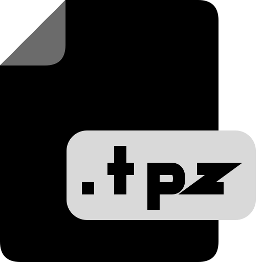
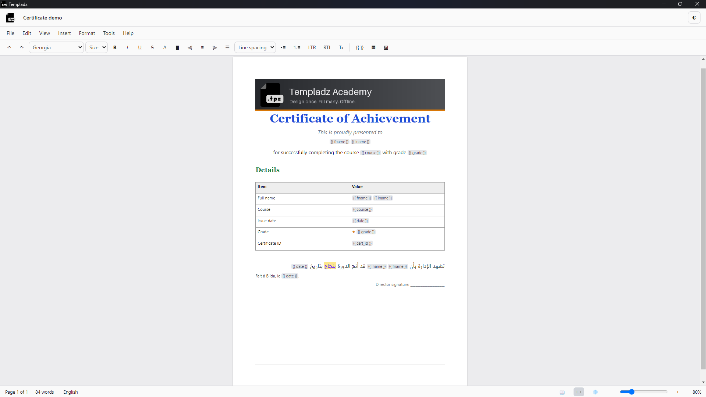
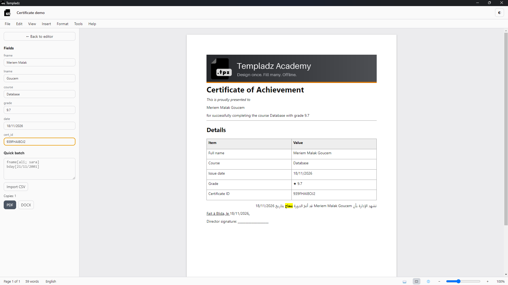
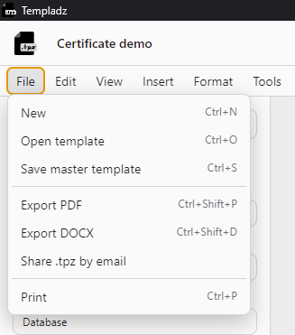
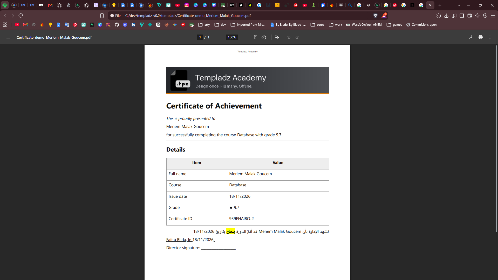

<h1 align="center">Templadz</h1>

Design a document once. Mark the variable parts. Generate hundreds of personalized copies, offline.

  

## Features
- **Word / Google Docs-style editor**: menu bar, formatting ribbon, tables, images, fonts, colors, lists, headers & footers, find & replace, zoom and view modes.
- **Reusable templates**: mark names, dates or IDs as variable fields `{{ field }}` and save a master template (`.tpz`).
- **Fast fill**: generate one copy through a live-preview form, or hundreds at once using quick-batch syntax (`fname[ali; sara] bday[21/11/2001]`) or by importing a CSV file.
- **Export & Share**: export directly to PDF and DOCX with a distinct filename for every generated copy, print directly, or share master templates as `.tpz` files.
- **Offline-first**: zero cloud dependencies—everything stays locally on your computer.
- **Multilingual & RTL**: full support for English, Français, and العربية with native right-to-left (RTL) text direction.
- **Neutral gray design**: clean, distraction-free interface with light and dark modes.

---

## Screenshots & Workflow

### 1. Design Your Master Template
Use the rich-text editor to build layouts with tables, custom fonts, highlights, and multilingual text (LTR & RTL), inserting `{{ field }}` placeholders wherever dynamic data belongs.

### 2. Fill Variables & Batch Generate
Switch to the fill panel to populate fields individually with a real-time document preview, use the quick-batch syntax, or import a `.csv` dataset.

| Live Form & Batch Fill | File Menu & Export Options |
| :---: | :---: |
|  |  |

### 3. Export Clean PDFs & DOCX Files
Export ready-to-distribute documents with automatically generated filenames (e.g., `Certificate_demo_Meriem_Malak_Goucem.pdf`).

---

## Sample Files
Explore the included demo files in `examples/` to test the full workflow right away:
- **`examples/certificate-demo.tpz`** — Master template containing `{{ fname }}`, `{{ lname }}`, `{{ course }}`, `{{ grade }}`, `{{ date }}`, and `{{ cert_id }}` fields with English, French, and Arabic RTL formatting.
- **`examples/Certificate_demo_Meriem_Malak_Goucem.pdf`** — Sample personalized PDF output generated from the demo template.

> **Note on Screenshot Paths:** Save your four screenshots inside `docs/screenshots/` using the filenames referenced above (`editor.png`, `fill-mode.png`, `file-menu.png`, and `exported-pdf.png`), or update the image paths to match your repository structure.

---

## Stack
Electron · React · TypeScript · Tiptap/ProseMirror · docx · Vite

## Status
Version 0.2 (early). Windows first. See [CHANGELOG](CHANGELOG.md), [documentation](docs/DOCUMENTATION.md), and the [security checklist](docs/SECURITY_CHECKLIST.md). To run or build it, follow [SETUP](SETUP.md).

## License
MIT. See [LICENSE](LICENSE).